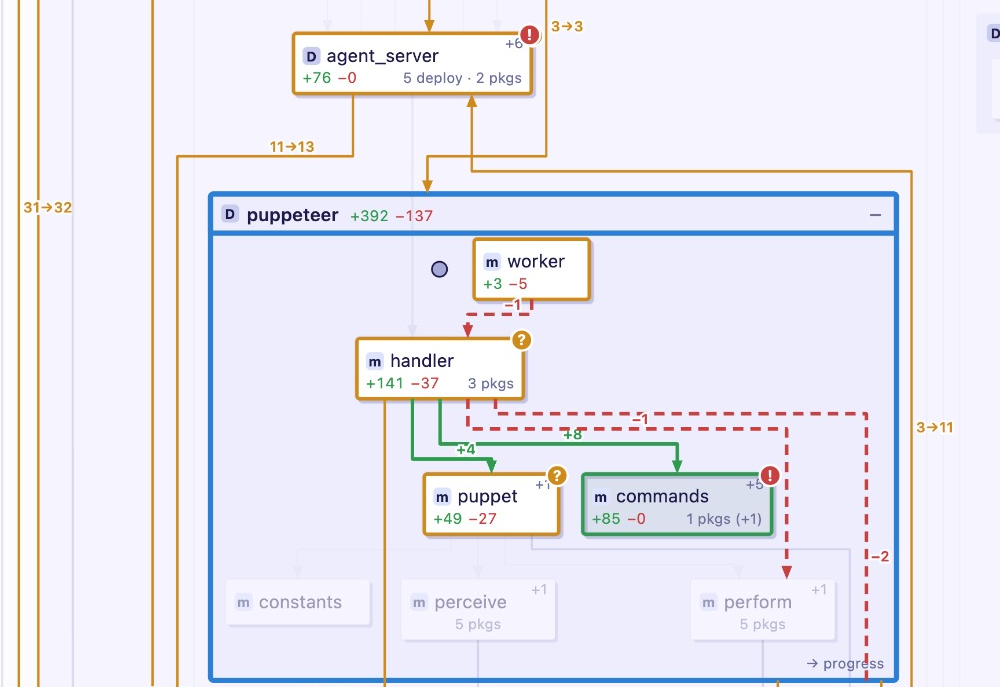

# Nolli

Nolli draws a pull request as a change to a repository's architecture: the components,
modules and classes it touches, the dependencies between them that it adds, removes or
changes, and how much each one changed.

> [!NOTE]
> [Giambattista **Nolli**](https://en.wikipedia.org/wiki/Giambattista_Nolli), commissioned
> by Pope Benedict XIV, surveyed Rome from 1736 and published his ichnographic plan of the
> city in 1748, by far the most accurate map of Rome up to then. It draws buildings as
> solid blocks but leaves enclosed public spaces open, the interiors of churches and
> courtyards among them: the plan shows what is inside where it matters for moving through
> the city.

## How to use

In a git repository:

```
nolli view                  # the current branch against the default branch
nolli view '#48'            # a GitHub pull request, or its URL
nolli view <base>..<head>   # any two revisions
```



`nolli view` builds the change and opens it in the browser. It also takes a branch or a
commit (what it adds to the default branch; a commit already merged, its own change) and
`<base>...<head>` (from where the two diverged). A pull request is fetched from GitHub
with its title, description and links; the title and description of any other change
come from its commits. Only commits count, not uncommitted edits; the repository is read
through `git archive`, and its working tree is not touched. On the default branch with
nothing new, it shows the whole repository. The viewer needs no internet, and a change
is built once (in `$NOLLI_DATA`, default `~/.local/share/nolli`).

To install (Python 3.11 or later):

```
pipx install git+https://github.com/ioleit/nolli
```

or `pip install -e .` in a clone of this repository.

To write a change or a single commit to a directory of your choice:

```
nolli diff <repo> <base> <head> -o data/<name>   # --pr, --title, --description for what view fills in
nolli extract <repo> -o data/<name>
python viewer/serve.py --data data               # from a clone; serves every dataset under data/
```

## Reviewing with an agent

Install the skill for your coding agent, then ask it to review a change with Nolli
("review PR #48 with nolli"):

```
nolli agent skill --install ~/.claude/skills    # or .claude/skills in a project
```

The agent runs `nolli agent brief <change>`, which builds the change and writes
`review.md`: a brief with the change's title, a Mermaid diagram of everything that
changed, how to review it, and the description. The agent answers with a JSON list:

```json
[
  {"target": "n_app_api", "verdict": "question", "reason": "…"},
  {"target": "n_app_worker --> n_app_api", "verdict": "problem", "reason": "…"}
]
```

where `target` is a node or an edge of the diagram and `verdict` is `fine`, `question`
or `problem`. It saves that as `verdicts.json` next to the brief, checks it with
`nolli agent check` (every target a box or edge drawn in the diagram, every verdict with
a reason) and opens the viewer: the verdicts appear as markers on the boxes and edges
they are about, and the review column lists them with their reasons, worst first.
Without the skill, `nolli agent brief` prints where the brief is; give it to any agent.

Nolli itself calls no model: the diagram is computed from the code, and the same two
commits always give the same picture.

## What it reads

| Framework | Status | Note |
|---|---|---|
| Python |  | imports, classes and references between them |
| FastAPI, Starlette |  | routes from `@router.get(...)`-style decorators, `APIRouter` prefixes, `include_router` chains |
| Flask |  | `@app.get(...)`-style routes; `@app.route` and blueprint prefixes are not read |
| `os.environ`, `os.getenv` |  | environment variables a module reads |
| TypeScript, JavaScript |  | imports between modules (`.ts`, `.tsx`, `.js`, `.jsx`, `.mjs`, `.cjs`) |
| `fetch`, axios, `EventSource`, `WebSocket` |  | HTTP calls, bound to the backend route with the same path shape; one level of helper function is followed |
| `process.env`, `import.meta.env` |  | environment variables a module reads |
| docker-compose |  | services, `depends_on`, service URLs in environment values, the variables each service sets |
| Dockerfile |  | which directories go into an image (`COPY`, `ADD`) and its entrypoint |

Other languages show up as files and directories only.

## License

Apache 2.0, see [LICENSE](LICENSE).
